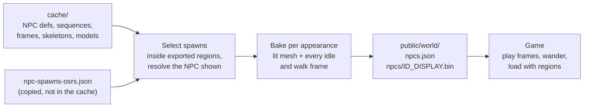

# NPC export: findings

Why the game had no NPCs, what the cache does and does not contain, and how NPCs now get from
the cache into the game. Verified against OSRS revision 242 (OpenRS2 cache #2757).

## Question

The project downloads an OSRS cache (the download step was built from rs-map-viewer). The cache
should have NPCs, but the game showed none. Did the download throw NPC data away?

## Findings

### 1. The download keeps everything

`scripts/download-cache.mjs` unpacks the whole OpenRS2 `disk.zip` (`main_file_cache.dat2` plus all
24 index files), the same as rs-map-viewer's `download-caches.js`. The cache on disk contains:

| Data                          | Where                       | Count  |
| ----------------------------- | --------------------------- | ------ |
| NPC definitions               | index 2, archive 9          | 16,858 |
| Animation sequences           | index 2, archive 12         | 15,167 |
| Animation frame groups        | index 0                     | 11,314 |
| Animation skeletons           | index 1                     | 2,787  |
| Skeletal animation groups     | index 22                    | 1,059  |
| Models                        | index 7                     | 62,769 |

### 2. The export threw it away

Nothing was lost in the download. The loss was in the exporter:

- `tools/world-export/WorldLoaders.ts` only opened the configs, maps, models, sprites and
  textures indexes, and said so: "minus everything that is not needed for static map geometry
  (npcs, objs, animations)".
- The NPC, sequence and animation decoders were never copied from rs-map-viewer, and
  `rs/model/Model.ts` had its animation code removed ("the world is static").
- The README stated "NPCs and ground items are not exported."

### 3. The cache does not say where NPCs stand

This is the part the download could never have supplied. Spawn positions are server data.

- Every rev 242 map square is one group of 5 files: 0 terrain, 1 locs, 2 a 228-byte per-area
  settings block (233 variants, looks like lighting), and 3 and 4 which are **empty in all 2,949
  squares**.
- There are no legacy `n{x}_{y}` NPC spawn groups in the map index.
- rs-map-viewer knows this: its `ModernMapFileLoader.getNpcSpawnData` returns `undefined`. For
  OSRS it uses a bundled list, `npc-spawns-osrs.json` (24,143 spawns as `{ id, name, x, y,
  level }`, 12,449 on the surface). This project copies that file to
  `tools/world-export/data/npc-spawns-osrs.json`.

### 4. rs-map-viewer's NPC decoder is out of date for rev 242

Its `NpcType` threw "Opcode 124 not implemented" on 43 of the 16,858 definitions (for example
Black demon, Seagull, Greater demon). Trying payload sizes, a **16-bit height** is the only one
that decodes all 43 with no leftover bytes (Black demon = 459, Seagull = 50). It is fixed in
`tools/world-export/rs/config/npctype/NpcType.ts`. `SeqType` decoded all 15,167 sequences.

### 5. Name matching must understand multi-NPCs and colour tags

rs-map-viewer keeps a spawn only if the cache NPC's name equals the list's name. In rev 242 that
drops many valid spawns:

- **Multi-NPCs** (which NPC shows depends on a varbit) have the name `null` in the cache while the
  list holds the real name. Resolving the transform with all variables 0, then falling back to any
  state with a matching name, recovers them.
- Some names carry markup, for example `<col=00ffff>Iceberg</col>`.

With that, about 12,200 of the 12,449 surface spawns match (rs-map-viewer's exact-name rule would
lose roughly 2,800).

### 6. Almost all NPC animations are frame-based

Of the 3,634 NPC types on the surface, 3,559 have a frame-based idle animation (14.4 frames on
average), 4 have a skeletal one and 55 have none. Skeletal animations are decoded with code from
rs-map-viewer (BSD-2-Clause, `tools/world-export/rs/model/skeletal/`, its gl-matrix calls replaced
by a small shim, `glm.ts`) and baked like frame ones, sampled every few client cycles so a clip has
at most 32 frames. Their attacks are found by name among the sequences on the same skeletal base.

## How NPCs now get into the game



- **Export** (`npm run export-world`, skip with `--no-npcs`): `NpcSpawns.ts` selects and resolves
  spawns, `NpcModelBuilder.ts` lights each appearance and records the vertex positions of every
  frame, and workers write one gzip file per appearance. Layout: `src/world/NpcFormat.ts`.
- **Game**: `Npcs` creates NPCs when `World` loads a region and removes them on unload. Each NPC
  copies baked positions into its mesh; no RuneScape animation code runs in the browser.
  Wandering follows rs-map-viewer: a 10% chance per 600 ms tick to pick a target within 5 tiles
  of the spawn, a breadth-first path that respects walls and objects, and smooth movement per
  20 ms client cycle.
- The refactor of `RegionBuilder` (colour handling moved to `FaceColors.ts`) leaves region output
  unchanged: region 50,50 decompresses to byte-identical data before and after.

## Result of the full export

```
NPCs: 12083 spawns, 3472 appearances (3111 can walk, 3160 with attacks), 135 MiB; skipped 11694 outside the area,
237 name mismatches, 0 without model, 127 without idle animation
```

125 appearances have attack styles beyond melee (from the wiki); 10 of their extra styles reuse the
melee animation because the cache has none of its own (the Suqah has no cast, for example), and
Callisto and Vet'ion (skeletal, without clips then) now bake theirs like the rest.

`public/world/npcs/` is about 140 MB on disk.

### Why spawns were skipped

| Reason                   | Count  | Explanation                                                                                                            |
| ------------------------ | ------ | ---------------------------------------------------------------------------------------------------------------------- |
| Outside the exported area | 11,694 | The default area is the surface (map y 65 and below). Dungeons, minigames and instances are not exported; `--area all` includes them. |
| Name mismatch            | 237    | The list dates from 2023. If the cache NPC with that id has a different name, the id was likely renumbered; it is skipped rather than shown wrongly. |
| No idle animation        | 127    | Neither the spawn's NPC nor the one shown has an idle sequence. rs-map-viewer skips these too. Not inspected by name yet. A hand-added spawn marked `still` in `data/npc-spawn-overrides.json` (the Great Olm) is kept in its base pose; one marked `summonOnly` (Scurrius's giant rats, Bryophyta's growthlings) is baked but not placed. |
| No model                 | 0      |                                                                                                                        |

## Attack animation audit (November 2026)

`npx tsx tools/world-export/audit-npc-attacks.ts` checks the attack clips of every exported NPC
against their sequence names and writes `out/attack-audit.json`. The first run, over 1,571
attackable appearances, found:

- **Numbered names were misread.** `NPC_CALLISTO_ATTACK_RANGED01` kept `RANGED01` as one word, so
  Callisto and Artio swung their ranged animation as a melee attack, and `MAHJARRAT_ATTACK_MAGIC01`
  was a melee swing for General Khazard and Azzanadra. Numbers are now split off and ignored when
  names are compared.
- **Idles, roars and summons counted as attacks** (`TOP_SPIDER_MELEE_IDLE` for Nylocas Vasilias,
  Zebak's roar, the Mahjarrat summon). They are excluded now.
- **A creature's own family word excluded its attack**: `ELEMENTAL_FIRE_ATTACK` was dropped as
  "fire" breath, so the fire elemental had no attack, and fire giants used the plain giant's. A word
  the idle's name shares names the family and no longer excludes (not on the player's skeleton,
  where the idle names a stance: crossbow guards keep their sword).
- **Clips that do not move** (the 4-cycle `DEMON_UPDATE_ATTACK` of every demon) are no longer baked.
- **Bosses whose other styles reused their melee animation**, set in `data/npc-attack-overrides.ts`
  from the OSRS Wiki's account of each fight: Corporeal Beast (sprite shot), Vorkath (fireball spit),
  Cerberus, Sotetseg, Zebak, the Leviathan (orb volleys), the Kalphite Queen (lightning), the
  Skeletal Wyvern (iceball), the fossil wyverns, TzHaar-Xil (ring throw), Experiment No.2 (throw)
  and Nylocas Vasilias.
- **The blow landed at the wrong moment** for long weapons (Akkha's spear at cycle 5 of 60, the
  Warden at 86 of 90, a fire giant's slash at 38 of 40), because the impact was the frame of
  furthest forward reach, which a spear or a sideways slash reaches at rest. It is now the end of the
  fastest forward-and-down stroke, not counting the first step: 155 melee clips (the staff pound of
  82 human NPCs, ogres, wolves) open with a snap from their first frame into the swing, which won
  over the blow itself. Renders of over 40 NPCs (rest pose and each attack at its hit, and whole
  swings frame by frame, through `tools/blender/attack_poses.ts` and `render_attack_poses.py`)
  checked it; the one doubtful case is Nylocas Vasilias, whose quick leg snap at 51 of 60 beats its
  strike at 35.
- **Cave goblins swung a club they do not hold**: "CLUB" was not a weapon word, so
  `DORGESH_GOBLIN_CLUB_ATTACK` tied with their unarmed attack. It is one now.
- **Seagulls and ducks had no attack**, though the wiki gives both a melee attack: they idle with
  the duck's sequence, and the only attack on that skeleton is `SEAGULL_ATTACK`. When no attack
  shares the idle's family, the skeleton's best one is taken now (it fits the rig).
- **Effect sequences were picked as attacks** (`VFX_DJINN_01_MAGIC_01` for the Killerwatt, whose
  skeleton is an effects one). `VFX` sequences are excluded; the Killerwatt has no body animation of
  its own and attacks without one.

Styles still sharing the melee animation are those the cache gives no other for (dark beasts, the
revenants, the Suqah, metal dragons' ranged attack); the wiki describes no separate pose for them.

## Limitations

- Per-frame alpha changes are not baked; faces keep their base alpha (skeletal ones included).
- NPCs are solid for the player (cylinder collision, see `src/physics/Bodies.ts`). Attack
  animations are baked since format 3 (melee) and, since format 4, one per extra attack style
  (breath, cast, bow shot, spit) for the NPCs the OSRS wiki gives several styles. Format 5 adds
  extra clips a boss fight plays by sequence id (`extraSeqs` in `data/npc-attack-overrides.ts`):
  Scurrius's stomp, summon, eating, run, enrage and death; Bryophyta's stamp and death; Obor's and
  the King Black Dragon's deaths; Callisto's and Artio's roar and death. Deaths are otherwise ragdolls, though the
  cache has death sequences. Which styles an NPC uses is not in the cache (server
  data): `npm run fetch-wiki-attacks` refreshes `data/npc-attacks-wiki.json` from the wiki, and
  `tools/world-export/list-npc-seqs.ts <npcId>` lists the named sequences of an NPC's skeleton
  when an attack needs an explicit sequence in `data/npc-attack-overrides.ts`.
- Combat stats: the cache's NPC definitions carry the combat levels in opcodes 74-79 (attack,
  defence, strength, hitpoints, ranged, magic), and the NPC `params` carry some bonuses with the same
  ids as item bonuses (5-8 defence; the attack bonus and often the ranged defence are missing). The
  exporter fills the gaps from the wiki's `infobox_monster` bucket (`npm run fetch-wiki-attacks`)
  and writes them as `NpcAppearanceInfo.combat`, with drop tables (the wiki's `dropsline` bucket)
  as `drops`. A page with several versions of its table (members and free-to-play, a monster's
  areas) keeps one: the members one, else the one named for the NPC level, else the first, beside
  the rows every version shares. Keys, clue scrolls and the like are tertiary rows that roll on
  their own; the main table is one roll, scaled to fit where the wiki's chances add up past 1.
- Items: item definitions carry the examine text (opcode 3), the stackable flag (11), the inventory
  icon camera (4-8 and 95) and scale (110-112), and the equipment bonuses, attack speed (param 14)
  and skill requirements (params 434-437) as params: 0-4 attack, 5-9 defence, 10 melee strength,
  12 ranged strength on ammunition, 189 on weapons, 299 magic damage in tenths of a percent.
  `npm run export-items` writes each inventory model like an NPC model plus `items.json`; the game
  renders the icons itself with the OSRS sprite camera.
- Wandering is client-side only and uses a simplified size-N footprint rule.
- The spawn list is from 2023. Newer content has no spawns until the list is updated.
- Ground items come from the wiki's item spawn lines (`npm run fetch-wiki-items`), written to
  `ground-items.json`; bank booths and chests are exported as `bank` interactives (the boss chests
  of Obor and Bryophyta are skill locs, from `export-skills`).
- Spot animations (config archive 13, `rs/config/spotanimtype/SpotAnimType.ts`): opcode 1 model
  (u16), 3 model (int, rev 242 uses this), 2 sequence, 4/5 width and height scale, 6 orientation
  (degrees), 7/8 ambient and contrast, 10 a flag with no data (the Surge impacts), 40/41 recolours
  and retextures. Spell graphics are baked from them by `npm run export-spells`; a skeletal
  sequence (Callisto's red enrage glow) is sampled every few cycles, and a `"<id>@<seq>"` id bakes
  a graphic's model with another sequence (Callisto's bear trap, whose idle and spring the cache
  gives its loc 47146).

## Tests

| File                                             | What it affirms                                                                   |
| ------------------------------------------------ | --------------------------------------------------------------------------------- |
| `rs/config/npctype/NpcType.test.ts`              | Real rev 242 bytes decode, including opcode 124 and multi-NPC transforms          |
| `rs/config/seqtype/SeqType.test.ts`              | Real animation sequences decode with correct frame ids and lengths                |
| `rs/model/seq/SeqFrame.test.ts`                  | A real skeleton and frame decode to known values                                  |
| `rs/model/Model.test.ts`                         | Translate, rotate, scale and alpha animation move the right vertices              |
| `NpcSpawns.test.ts`                              | Name matching, multi-NPC resolution, skip reasons, facing, manifest finalizing    |
| `NpcModelBuilder.test.ts`                        | Face rules, clip baking, bounds; colour mapping                                   |
| `src/world/NpcFormat.test.ts`                    | File format round trip and rejection of bad files                                 |
| `src/npc/NpcAnimation.test.ts`                   | Frame timing, position copying, facing direction                                  |
| `src/npc/NpcMovement.test.ts`                    | Collision rules, pathfinding (including real world coordinates), turning          |
| `src/npc/Npcs.test.ts`                           | Load, unload, cancelled loads, wandering, walls                                   |
| `npc-pipeline.test.ts`                           | End to end against real data: see below                                           |

`npc-pipeline.test.ts` is the one that checks the pieces work together. It always checks the
committed spawn list. When `cache/` exists it decodes every NPC and sequence definition without
errors, selects Lumbridge's NPCs, bakes them all, round-trips them through the file format, and
plays a real baked Man in the game runtime to confirm it animates and wanders. When
`public/world/npcs.json` exists it checks the exported world: every model file exists and
decodes, every spawn points at a valid appearance inside an exported region, and animation data
is consistent. Without the exported world that section is skipped and the rest of
the suite still passes.

## Reproducing the checks

```bash
npm run download-cache
npm run export-world        # prints the NPC summary line above
npm test                    # includes the end-to-end tests when the data exists
npm run dev                 # open /?x=3222&y=3218 and look for Hans, the Cook and the guards
```
