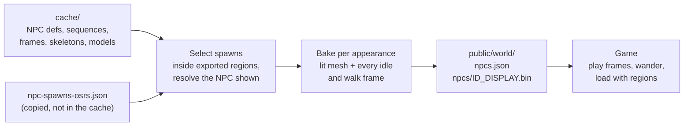

# NPC export: findings

Why the game had no NPCs, what the cache does and does not contain, and how NPCs now get from
the cache into the game. Verified against OSRS revision 242 (OpenRS2 cache #2757).

## Question

The project downloads an OSRS cache (the download step was built from rs-map-viewer). The cache
should have NPCs, but the game showed none. Did the download throw NPC data away?

## Findings

### 1. The download keeps everything

`scripts/download-cache.mjs` unpacks the whole OpenRS2 `disk.zip` (`main_file_cache.dat2` plus all
24 index files), the same as rs-map-viewer's `download-caches.js`. The cache on disk contains:

| Data                          | Where                       | Count  |
| ----------------------------- | --------------------------- | ------ |
| NPC definitions               | index 2, archive 9          | 16,858 |
| Animation sequences           | index 2, archive 12         | 15,167 |
| Animation frame groups        | index 0                     | 11,314 |
| Animation skeletons           | index 1                     | 2,787  |
| Skeletal animation groups     | index 22                    | 1,059  |
| Models                        | index 7                     | 62,769 |

### 2. The export threw it away

Nothing was lost in the download. The loss was in the exporter:

- `tools/world-export/WorldLoaders.ts` only opened the configs, maps, models, sprites and
  textures indexes, and said so: "minus everything that is not needed for static map geometry
  (npcs, objs, animations)".
- The NPC, sequence and animation decoders were never copied from rs-map-viewer, and
  `rs/model/Model.ts` had its animation code removed ("the world is static").
- The README stated "NPCs and ground items are not exported."

### 3. The cache does not say where NPCs stand

This is the part the download could never have supplied. Spawn positions are server data.

- Every rev 242 map square is one group of 5 files: 0 terrain, 1 locs, 2 a 228-byte per-area
  settings block (233 variants, looks like lighting), and 3 and 4 which are **empty in all 2,949
  squares**.
- There are no legacy `n{x}_{y}` NPC spawn groups in the map index.
- rs-map-viewer knows this: its `ModernMapFileLoader.getNpcSpawnData` returns `undefined`. For
  OSRS it uses a bundled list, `npc-spawns-osrs.json` (24,143 spawns as `{ id, name, x, y,
  level }`, 12,449 on the surface). This project copies that file to
  `tools/world-export/data/npc-spawns-osrs.json`.

### 4. rs-map-viewer's NPC decoder is out of date for rev 242

Its `NpcType` threw "Opcode 124 not implemented" on 43 of the 16,858 definitions (for example
Black demon, Seagull, Greater demon). Trying payload sizes, a **16-bit height** is the only one
that decodes all 43 with no leftover bytes (Black demon = 459, Seagull = 50). It is fixed in
`tools/world-export/rs/config/npctype/NpcType.ts`. `SeqType` decoded all 15,167 sequences.

### 5. Name matching must understand multi-NPCs and colour tags

rs-map-viewer keeps a spawn only if the cache NPC's name equals the list's name. In rev 242 that
drops many valid spawns:

- **Multi-NPCs** (which NPC shows depends on a varbit) have the name `null` in the cache while the
  list holds the real name. Resolving the transform with all variables 0, then falling back to any
  state with a matching name, recovers them.
- Some names carry markup, for example `<col=00ffff>Iceberg</col>`.

With that, about 12,200 of the 12,449 surface spawns match (rs-map-viewer's exact-name rule would
lose roughly 2,800).

### 6. Almost all NPC animations are frame-based

Of the 3,634 NPC types on the surface, 3,559 have a frame-based idle animation (14.4 frames on
average), 4 have a skeletal one and 55 have none. Skeletal animation needs gl-matrix and about
1,300 more lines of decoders, so those NPCs are shown in their base pose.

## How NPCs now get into the game



- **Export** (`npm run export-world`, skip with `--no-npcs`): `NpcSpawns.ts` selects and resolves
  spawns, `NpcModelBuilder.ts` lights each appearance and records the vertex positions of every
  frame, and workers write one gzip file per appearance. Layout: `src/world/NpcFormat.ts`.
- **Game**: `Npcs` creates NPCs when `World` loads a region and removes them on unload. Each NPC
  copies baked positions into its mesh; no RuneScape animation code runs in the browser.
  Wandering follows rs-map-viewer: a 10% chance per 600 ms tick to pick a target within 5 tiles
  of the spawn, a breadth-first path that respects walls and objects, and smooth movement per
  20 ms client cycle.
- The refactor of `RegionBuilder` (colour handling moved to `FaceColors.ts`) leaves region output
  unchanged: region 50,50 decompresses to byte-identical data before and after.

## Result of the full export

```
NPCs: 12083 spawns, 3472 appearances (3111 can walk), 85 MiB; skipped 11694 outside the area,
237 name mismatches, 0 without model, 127 without idle animation
```

`public/world/npcs/` is about 94 MB on disk.

### Why spawns were skipped

| Reason                   | Count  | Explanation                                                                                                            |
| ------------------------ | ------ | ---------------------------------------------------------------------------------------------------------------------- |
| Outside the exported area | 11,694 | The default area is the surface (map y 65 and below). Dungeons, minigames and instances are not exported; `--area all` includes them. |
| Name mismatch            | 237    | The list dates from 2023. If the cache NPC with that id has a different name, the id was likely renumbered; it is skipped rather than shown wrongly. |
| No idle animation        | 127    | Neither the spawn's NPC nor the one shown has an idle sequence. rs-map-viewer skips these too. Not inspected by name yet. |
| No model                 | 0      |                                                                                                                        |

## Limitations

- Skeletal animations (about 4 surface NPC types) show the base pose.
- Per-frame alpha changes are not baked; faces keep their base alpha.
- NPCs are visual only: the player walks through them, and there is no interaction, combat or
  death animation (those are not in the cache).
- Wandering is client-side only and uses a simplified size-N footprint rule.
- The spawn list is from 2023. Newer content has no spawns until the list is updated.
- Ground items are still not exported.

## Tests

| File                                             | What it affirms                                                                   |
| ------------------------------------------------ | --------------------------------------------------------------------------------- |
| `rs/config/npctype/NpcType.test.ts`              | Real rev 242 bytes decode, including opcode 124 and multi-NPC transforms          |
| `rs/config/seqtype/SeqType.test.ts`              | Real animation sequences decode with correct frame ids and lengths                |
| `rs/model/seq/SeqFrame.test.ts`                  | A real skeleton and frame decode to known values                                  |
| `rs/model/Model.test.ts`                         | Translate, rotate, scale and alpha animation move the right vertices              |
| `NpcSpawns.test.ts`                              | Name matching, multi-NPC resolution, skip reasons, facing, manifest finalizing    |
| `NpcModelBuilder.test.ts`                        | Face rules, clip baking, bounds; colour mapping                                   |
| `src/world/NpcFormat.test.ts`                    | File format round trip and rejection of bad files                                 |
| `src/npc/NpcAnimation.test.ts`                   | Frame timing, position copying, facing direction                                  |
| `src/npc/NpcMovement.test.ts`                    | Collision rules, pathfinding (including real world coordinates), turning          |
| `src/npc/Npcs.test.ts`                           | Load, unload, cancelled loads, wandering, walls                                   |
| `npc-pipeline.test.ts`                           | End to end against real data: see below                                           |

`npc-pipeline.test.ts` is the one that checks the pieces work together. It always checks the
committed spawn list. When `cache/` exists it decodes every NPC and sequence definition without
errors, selects Lumbridge's NPCs, bakes them all, round-trips them through the file format, and
plays a real baked Man in the game runtime to confirm it animates and wanders. When
`public/world/npcs.json` exists it checks the exported world: every model file exists and
decodes, every spawn points at a valid appearance inside an exported region, and animation data
is consistent. Without the cache or export (as in CI) those sections are skipped and the rest of
the suite still passes.

## Reproducing the checks

```bash
npm run download-cache
npm run export-world        # prints the NPC summary line above
npm test                    # includes the end-to-end tests when the data exists
npm run dev                 # open /?x=3222&y=3218 and look for Hans, the Cook and the guards
```
