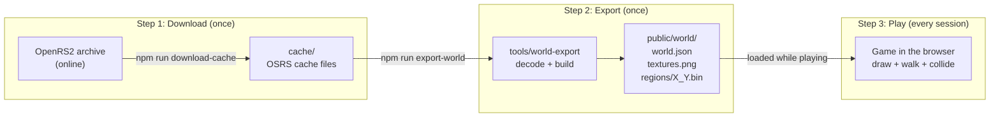
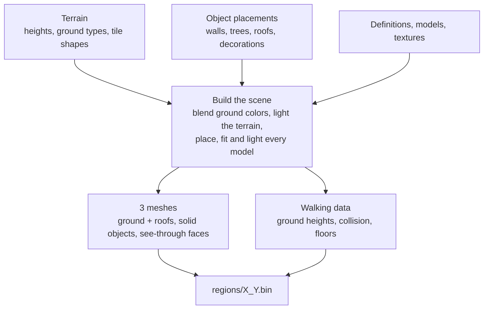

# From OSRS cache to world map

The game never reads the Old School RuneScape cache. The cache is converted **once** into
game-ready world files, and the game only ever loads those files.

## The three phases

| Phase       | Command                  | When                                          | Uses the cache?   | Produces                  |
| ----------- | ------------------------ | --------------------------------------------- | ----------------- | ------------------------- |
| 1. Download | `npm run download-cache` | Once, or to get a newer OSRS revision         | Fetches it        | `cache/` (~240 MB)        |
| 2. Export   | `npm run export-world`   | Once after downloading, or after code changes | Yes, the only one | `public/world/` (~1.5 GB) |

The export also needs the OSRS wiki data once (`npm run fetch-wiki-attacks` for NPC levels, bonuses,
max hits and attack styles; `npm run fetch-wiki-items` for drop tables, item spawns and food). After
`export-world`, which clears `public/world/`, run `npm run export-cache-weapons` and
`npm run export-items` (the item models and `items.json`). The order is: `fetch-wiki-attacks`,
`fetch-wiki-items`, `export-world`, `export-cache-weapons`, `export-items`.
`npm run export-world -- --npc-data-only` refreshes only the NPC stats, poison and drop tables in
`npcs.json` after new wiki data, in seconds, without re-baking the NPC models.
`npm run export-hitsplats` writes the OSRS hitsplat sprites and their digits from the cache to
`public/ui/` (outside `public/world/`, so the exports above never delete it).
| 3. Play     | `npm run dev`            | Every time you play                           | No                | The world, in the browser |

## 1. Download the cache

The cache is the game's data exactly as the OSRS client stores it: one large data file plus
index files that say where each piece lives, with everything compressed.

`npm run download-cache` picks the newest complete cache from the
[OpenRS2 archive](https://archive.openrs2.org/) (or a revision you name), downloads it and
unpacks it into `cache/`, along with an `info.json` that records the revision and date.

After this, the cache is only needed again if you re-export.

## 2. Export the world map

`npm run export-world` is the only step that reads the cache. It uses these kinds of data (plus one non-cache input, the NPC spawn list, below):

| Cache data                  | What it is used for                                                 |
| --------------------------- | ------------------------------------------------------------------- |
| Map squares (64 × 64 tiles) | Ground heights, the ground type of each tile, where objects stand   |
| Ground definitions          | Colors and textures of grass, paths, water, floors                  |
| Object definitions          | Which 3D models an object uses, its size, collision and lighting    |
| Models                      | The 3D shapes of walls, roofs, trees, furniture and everything else |
| Textures                    | Images painted on models and ground: water, bricks, roof tiles      |
| NPC definitions             | Which models an NPC uses, its size, idle and walk animations        |
| Animations                  | Per-frame bone movements that bend NPC models (idle, walk)         |

Each map square becomes one region file:

1. **Read** the square's terrain and object placements, plus a few tiles of its neighbors so
   colors and slopes blend across the edges.
2. **Build the scene**: blend the ground colors, light the terrain from a fixed sun, then put
   every object's model in place (rotated, recolored and fitted to the slope of the ground)
   and light it. Lighting is baked into the colors, so the game needs no lights.
3. **Record what the player needs**: ground heights for each of the 4 floor levels,
   collision (walls and blocked tiles, with doors left open), and which upper floors exist.
4. **Write** everything into `regions/X_Y.bin`, compressed.

**NPCs.** The cache says what an NPC looks like but not where it stands, so spawn positions
come from `tools/world-export/data/npc-spawns-osrs.json`. Spawns inside the exported regions
are matched to their NPC definition, each distinct appearance is lit and its idle, walk and
attack animations are baked frame by frame into `npcs/{id}_{displayId}.bin`, and the spawns are
written to `npcs.json` (with the attack styles of NPCs that use more than melee, from the OSRS wiki). The game plays the baked frames back and wanders the NPCs itself.

Besides the regions, the export writes `textures.png` (every texture in one image) and
`world.json` (the list of regions, the spawn point and texture settings). The 1,636 regions
of the surface world take about 5 minutes with 3 workers in parallel.

## 3. Play

The game starts from `world.json` and `textures.png`, then streams regions as you move:

- region files within about 100 tiles of the player are loaded, nearest first;
- regions more than about 140 tiles away are dropped again.

Each region file is used three ways: its meshes are drawn, its heights keep the player on the
ground (or on a bridge or upper floor), and its collision stops the player at walls.

## When to re-run what

| You changed...                                                     | Re-run                                   |
| ------------------------------------------------------------------ | ---------------------------------------- |
| Want a newer OSRS update                                           | `download-cache`, then `export-world`    |
| The exporter (`tools/world-export/`) or `src/world/WorldFormat.ts` | `export-world`, then `export-cache-weapons` and `export-items` |
| Only the game (`src/`)                                             | Nothing; the dev server reloads the page |
